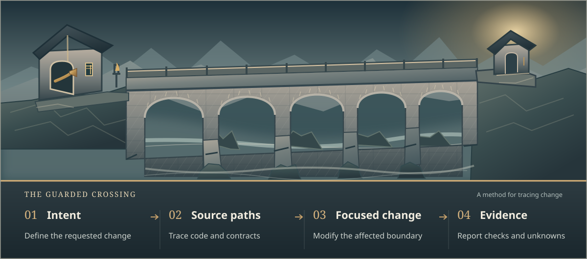

# Heimdall

**Trace the change. Preserve the contract. Verify the result.**

[](https://developers.openai.com/codex/ide)
[](LICENSE)

Heimdall gives Codex a disciplined way to work in real codebases. Use it with Codex CLI, the Codex IDE extension, Codex in the ChatGPT desktop app (Local, Worktree, or Cloud), or Codex on the web at [chatgpt.com/codex](https://chatgpt.com/codex/) to trace affected paths, make focused changes, and show evidence behind the result. It works with your existing language, framework, and tests.


**[Get started](marketing/SETUP.md)** · [See the method](marketing/HOW_IT_WORKS.md) · [Try a task](marketing/USAGE.md)

## Why Heimdall?

An AI-built checkout can work in a demo and charge a customer twice when a payment times out and gets retried. At that point, the team has to work out which system owns the payment state, what the customer actually paid, and whether a rollback would help or make things worse. The same team has to maintain that code after the chat ends.

Prompts, CI, and code review help. They work best when the team has already made the failure cases explicit. Heimdall gives Codex a process for doing that in the repository itself. Trace the existing code, agree on what must hold, make a bounded change, and show which checks support it. When several agents work on the change, each has a defined scope and hands off evidence the next agent can inspect. [See the method in practice](marketing/HOW_IT_WORKS.md#example-a-shared-access-rule).

<picture>
  <source media="(max-width: 640px)" srcset="marketing/heimdall-flow-mobile.svg">
  
</picture>

The [engineering playbook](marketing/ENGINEERING_PLAYBOOK.md) shows how to apply these methods to a single change, from defining its contract through testing recovery.

## Start in an existing project

Run the installer commands in **Linux Bash** or **WSL on Windows**. You need Git, Bash 4.4+, Python 3.9+, `jq`, and a signed-in Codex client. In the desktop app, choose Local or Worktree for local project files, or Cloud for a remote task. [Check the setup prerequisites](marketing/SETUP.md#prerequisites) and [app setup steps](marketing/SETUP.md#start-codex).

**1. Get Heimdall outside your application repository.**

```bash
mkdir -p "$HOME/tools"
git clone https://github.com/febshhy/heimdall-codex.git "$HOME/tools/heimdall-codex"
```

**2. Preview changes to your clean Git project.**

```bash
cd /path/to/your-project
bash "$HOME/tools/heimdall-codex/scripts/heimdall" start --project . --integrate-agents
```

**3. Review the plan, apply it, and verify installation.**

```bash
bash "$HOME/tools/heimdall-codex/scripts/heimdall" start --project . --integrate-agents --apply
bash .heimdall/install.sh --verify
```

Open the project in Codex CLI with `codex`, in the IDE extension, or in the ChatGPT desktop app and choose Local or Worktree. For Codex on the web, connect the repository at [chatgpt.com/codex](https://chatgpt.com/codex/) and follow the [app setup steps](marketing/SETUP.md#start-codex).

For a [new project](marketing/SETUP.md#new-project) or recovery, use the [setup guide](marketing/SETUP.md).

## Give Codex a first task

> Inspect the source and tests for the behavior I want to change. Trace the relevant production path using real names. Identify the shared contracts, failure cases, and unknowns. Recommend the smallest change and how to verify it. Do not edit files yet.

Review the findings before authorizing implementation. [Use prompts for bugs, UI, databases, writing, and coordinated work](marketing/USAGE.md#task-examples).

## Keep decisions and evidence in your control

Heimdall provides instructions, skills, and optional task-handoff checks. Your project defines approved behavior; its tools provide test and runtime evidence. Codex acts within the permissions you give it. Use an isolated execution environment for sensitive credentials.

[Understand responsibilities and verification](marketing/HOW_IT_WORKS.md#what-counts-as-evidence) · [Read security and setup guidance](marketing/SETUP.md#security-and-permissions) · [MIT license](LICENSE)

## The name behind Heimdall

<a href="https://commons.wikimedia.org/wiki/File:Heimdal_listening_next_to_Bifrost.jpg">
  
</a>

*Heimdal listening next to Bifrost*, Constantin Hansen. [Artwork and public-domain source](https://commons.wikimedia.org/wiki/File:Heimdal_listening_next_to_Bifrost.jpg).

Heimdall is named after the watchman of Bifröst.
