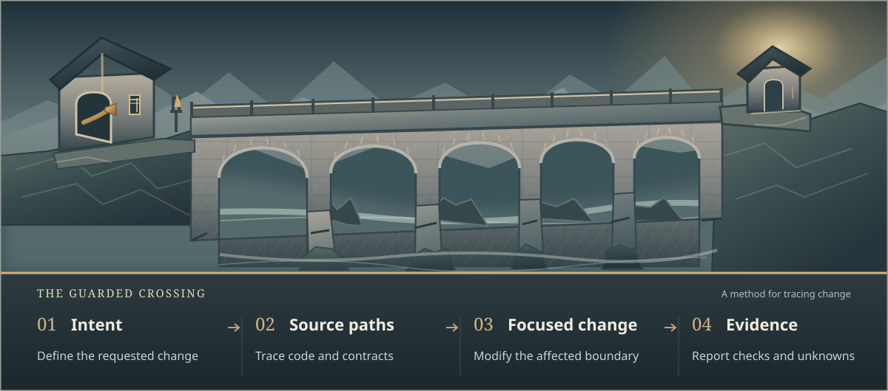

# Heimdall

**Trace the change. Preserve the contract. Verify the result.**

[](https://github.com/openai/codex)
[](LICENSE)

Heimdall gives Codex CLI a disciplined way to work in real codebases. It helps Codex trace the affected paths, make focused changes, and show the evidence behind the result. It works with your existing language, framework, and tests.


**[Get started](marketing/SETUP.md)** · [See the method](marketing/HOW_IT_WORKS.md) · [Try a task](marketing/USAGE.md)

## Why Heimdall?

A request that sounds small can change behavior in several places. A report-access rule, for example, may affect an API, an export, and a scheduled job. Editing one screen does not establish that every path enforces the rule.

Heimdall gives Codex three connected disciplines:

1. **Trace before editing.** Inspect actual source paths, requirements, state, effects, and failure cases. Mark unknowns rather than inventing dependencies.
2. **Change only what the task needs.** Respect existing architecture, compare realistic alternatives, and keep structural cleanup separate when useful. Delegate only when dependencies justify it.
3. **Verify what changed.** Relate claims to project checks, observed outcomes, and review. State what remains untested instead of calling it complete.

<picture>
  <source media="(max-width: 640px)" srcset="marketing/heimdall-flow-mobile.svg">
  
</picture>

The result is a change that is easier to inspect and maintain. [See how the method handles a shared access rule](marketing/HOW_IT_WORKS.md#example-a-shared-access-rule).

**Learn the engineering behind it:** [Engineering playbook](marketing/ENGINEERING_PLAYBOOK.md) explains the contracts, state machines, functional core, dependency boundaries, recovery, and verification you can apply in your own code.

## Start in an existing project

Run these commands in **Linux Bash** or **WSL on Windows**. You need Git, Bash 4.4+, Python 3.9+, `jq`, and Codex CLI. [Check the setup prerequisites](marketing/SETUP.md#prerequisites).

**1. Get Heimdall outside your application repository.**

```bash
mkdir -p "$HOME/tools"
git clone https://github.com/febshhy/heimdall-codex.git "$HOME/tools/heimdall-codex"
```

**2. Preview changes to your clean Git project.**

```bash
cd /path/to/your-project
bash "$HOME/tools/heimdall-codex/scripts/heimdall" start --project . --integrate-agents
```

**3. Review the plan, apply it, and verify installation.**

```bash
bash "$HOME/tools/heimdall-codex/scripts/heimdall" start --project . --integrate-agents --apply
bash .heimdall/install.sh --verify
codex
```

The first setup command previews the installation. Apply checks that the saved plan still matches the project. Heimdall preserves unrelated instructions and does not write to your project's `docs/` directory during installation.

For a [new project](marketing/SETUP.md#new-project), [global installation](marketing/SETUP.md#global-installation), or recovery, use the [setup guide](marketing/SETUP.md).

## Give Codex a first task

> Inspect the source and tests for the behavior I want to change. Trace the relevant production path using real names. Identify the shared contracts, failure cases, and unknowns. Recommend the smallest change and how to verify it. Do not edit files yet.

Review the findings before authorizing implementation. [Use prompts for bugs, UI, databases, writing, and coordinated work](marketing/USAGE.md#task-examples).

## Keep decisions and evidence in your control

Heimdall provides instructions, skills, and optional task-handoff checks. Your project defines approved behavior; its tools provide test and runtime evidence. Codex acts within the permissions you give it. For sensitive credentials, use an isolated execution environment rather than relying on written instructions alone.

[Understand responsibilities and verification](marketing/HOW_IT_WORKS.md#what-counts-as-evidence) · [Read security and setup guidance](marketing/SETUP.md#security-and-permissions) · [MIT license](LICENSE)

## The name behind Heimdall

<a href="https://commons.wikimedia.org/wiki/File:Heimdal_listening_next_to_Bifrost.jpg">
  
</a>

*Heimdal listening next to Bifrost*, Constantin Hansen. [Artwork and public-domain source](https://commons.wikimedia.org/wiki/File:Heimdal_listening_next_to_Bifrost.jpg).

Heimdall is named after the watchman of Bifröst. The image illustrates the namesake; the [engineering playbook](marketing/ENGINEERING_PLAYBOOK.md) explains the software principles behind the project.
